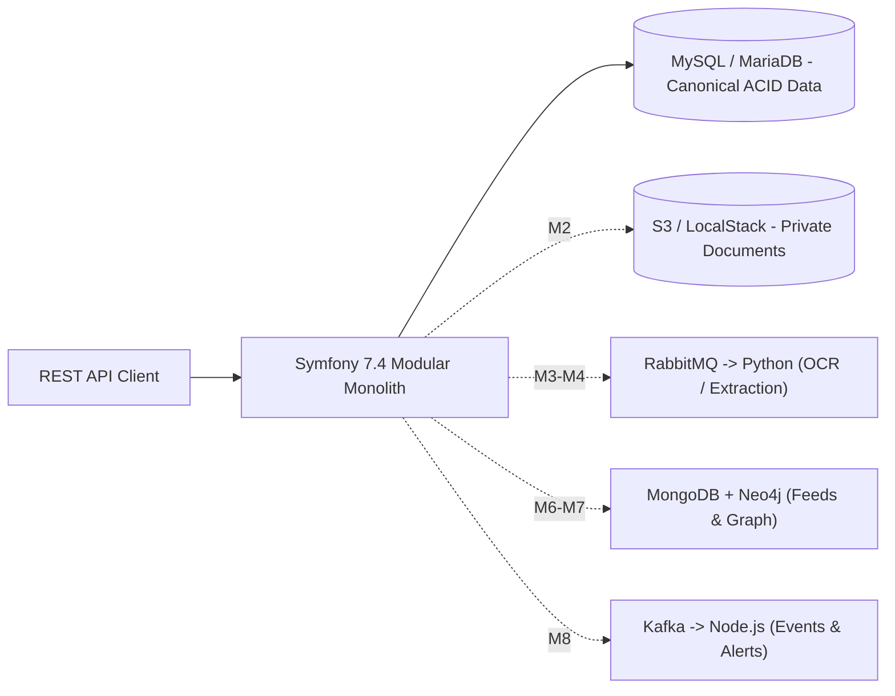

# BuildGuard — Construction Project Compliance Platform

**BuildGuard** is a production-style construction compliance backend inspired by **Procore**, built to answer one high-stakes operational question for General Contractors:

> **"Is this contractor allowed to work on this project today, and are all required insurance certificates, safety documents, and municipal permits valid?"**

*Note: This is a personal production-style engineering project built and tested locally across incremental milestones.*

---

## Architecture at a Glance

BuildGuard is structured as a **Symfony 7.4 LTS modular monolith** backed by **MySQL/MariaDB** as the canonical transactional store, evolving across milestones to integrate private object storage (**S3**), asynchronous job queues (**RabbitMQ + Python**), raw external feed storage (**MongoDB + Airflow**), relationship graphs (**Neo4j**), and durable domain event streaming (**Kafka + Node.js**).



| Architectural Choice | Rationale |
|---|---|
| **Modular Monolith first** (`src/<Module>/{Domain,Application,Infrastructure,Presentation,Tests}`) | Enforces strict domain boundaries (`Organizations`, `Identity`, `Projects`, `Contractors`, `Permits`, `Shared`) without premature microservice network/transaction overhead. |
| **MySQL / MariaDB** (Canonical) + **MongoDB** (Raw) + **Neo4j** (Graph) | ACID relational integrity for compliance state; schema-free raw municipal permit preservation for replay; Cypher graph traversal for cross-project contractor lineage. |
| **RabbitMQ** (Commands) + **Kafka** (Events) | RabbitMQ distributes retryable background extraction tasks with DLQs; Kafka retains immutable domain facts (`ContractorBecameNonCompliant`) for replayable read models. |

For the full business domain, 15-table ER diagram, and sequence flows, see **[docs/system-blueprint.md](file:///e:/construction-compliance-platform/docs/system-blueprint.md)**.

---

## Engineering Highlights (Implemented & Verified)

- **Zero N+1 & Zero Cartesian Explosion ([ProjectRepository.php](file:///e:/construction-compliance-platform/src/Projects/Infrastructure/Repository/ProjectRepository.php)):** Uses 4-step `IN (:ids)` Doctrine hydration (`Project + Organization` join followed by targeted collection hydration via Doctrine's Identity Map), guaranteeing constant `O(1)` query count regardless of project count and verified via `PersistentCollection::isInitialized()` assertions.
- **Composite Indexing Verified with `EXPLAIN` ([Version20261122211041.php](file:///e:/construction-compliance-platform/migrations/Version20261122211041.php)):** Foreign keys and high-selectivity filter pairs (`(organization_id, status)`, `(project_id, status)`, `expires_at`, `normalized_name`) are indexed and verified with `EXPLAIN` (`type=ref`, `Using index condition`).
- **Bounded-Memory Batch Processing ([AppFixtures.php](file:///e:/construction-compliance-platform/src/Shared/DataFixtures/AppFixtures.php)):** Bulk contractor seeding flushes and clears Doctrine's `UnitOfWork` every 10 records (`flush()` + `clear()`) to keep memory usage flat.
- **Strict Input Validation & Predictable HTTP Contracts ([JsonRequestHelper.php](file:///e:/construction-compliance-platform/src/Shared/Presentation/Http/JsonRequestHelper.php)):** Request payloads are parsed into typed DTOs validated with `symfony/validator`, returning `400` (malformed JSON), `404` (missing parent), `409` (duplicate unique business key), or `422` (field-level violations) — never raw `500` SQL errors.
- **Fail-Fast, Leak-Free Health Probe ([DoctrineDatabaseHealthProbe.php](file:///e:/construction-compliance-platform/src/Shared/Infrastructure/Health/DoctrineDatabaseHealthProbe.php)):** `GET /health` runs `SELECT 1` behind a domain port (`PDO::ATTR_TIMEOUT = 2s`), returning `200 OK` or a sanitized `503 Service Unavailable` payload while logging driver diagnostics to Monolog.

---

## Implementation Progress

| Milestone | Scope | Status | Verification |
|---|---|---|---|
| **0 — Foundation** | Symfony 7.4 LTS, Doctrine DBAL, Monolog, `/health`, PHPUnit, DB-outage drill | **Done** | Unit, DBAL integration & functional tests |
| **1 — Core Domain** | `Organizations`, `Identity`, `Projects`, `JobSites`, `Contractors`, `Permits`, migrations, fixtures, REST API | **Done** | `11 tests, 117 assertions` + `EXPLAIN` + schema validation |
| **2 — Documents** | Upload API, MIME/size validation, SHA-256 deduplication, private S3 storage, audit log | Next | — |
| **3–5 — Async & Compliance** | RabbitMQ + Symfony Messenger, Python metadata extractor, Compliance rule engine | Planned | — |
| **6–8 — Data & Events** | MongoDB permit importer, fuzzy entity resolution + Neo4j, Kafka + Node.js alerts | Planned | — |
| **9–15 — Ops & Cloud** | Prometheus/Grafana/OpenSearch, Docker hardening, K8s/Helm, Terraform, CI/CD, Airflow | Planned | — |

---

## API Endpoints (Milestones 0–1)

| Method | Path | Description |
|---|---|---|
| `GET` | `/health` | Readiness probe (`200` healthy / `503` degraded, zero leaked internals) |
| `GET / POST` | `/api/organizations`, `/api/organizations/{id}` | Create & list tenant organizations |
| `GET / POST` | `/api/users` | Create & filter users (`?organization_id=`, `?role=`) |
| `GET / POST` | `/api/projects`, `/api/projects/{id}` | Create & inspect projects with eager-loaded sites, contractors & permits |
| `POST` | `/api/projects/{id}/job-sites` | Register a physical job site & jurisdiction under a project |
| `POST` | `/api/projects/{id}/contractors` | Assign a trade contractor to a project (`409` on duplicate assignment) |
| `GET / POST` | `/api/contractors`, `/api/contractors/{id}` | Manage trade contractors (`?trade=`, `?status=`, auto-normalized company names) |
| `GET / POST` | `/api/permits` | Track municipal permits (`?project_id=`, `?status=`, expiration dates) |

<details>
<summary><strong>Sample Response: <code>GET /api/projects/1</code></strong></summary>

```json
{
  "data": {
    "id": 1,
    "organization_id": 1,
    "organization_name": "Apex Builders Group",
    "name": "Downtown Tower",
    "code": "DT-2026",
    "status": "active",
    "starts_at": "2026-01-15",
    "ends_at": "2028-06-30",
    "job_sites": [
      {
        "id": 1,
        "name": "North Core Parcel",
        "city": "Austin",
        "state": "TX",
        "jurisdiction": "City of Austin"
      }
    ],
    "contractors": [
      {
        "company_id": 1,
        "company_name": "ABC Electrical LLC",
        "trade": "electrical",
        "company_status": "non_compliant",
        "role_on_project": "High-Voltage Electrical Subcontractor",
        "status": "active"
      }
    ],
    "permits": [
      {
        "permit_number": "AUS-BLD-2026-001",
        "permit_type": "building",
        "status": "approved",
        "expires_at": "2027-07-10"
      }
    ]
  }
}
```
</details>

---

## Quickstart (Local PHP 8.2+ & MySQL/MariaDB)

```powershell
# 1. Configure local environment (never commit .env)
Copy-Item .env.example .env

# 2. Run schema migrations (dev + test) and seed realistic construction data
php bin/console doctrine:migrations:migrate --no-interaction
php bin/console doctrine:migrations:migrate --env=test --no-interaction
php bin/console doctrine:fixtures:load --no-interaction

# 3. Validate Doctrine mappings & run automated test suite (11 tests, 117 assertions)
php bin/console doctrine:schema:validate
php bin/phpunit

# 4. Start local API server
php -S 127.0.0.1:8085 -t public
curl.exe -sS http://127.0.0.1:8085/health
curl.exe -sS http://127.0.0.1:8085/api/projects
```

*(Docker configuration in [compose.yaml](file:///e:/construction-compliance-platform/compose.yaml) and [docker/](file:///e:/construction-compliance-platform/docker/) is parked for end-of-project multi-service containerization.)*

---

## Documentation & Deep Dives

- **[System Blueprint, Business Domain & Full Schema](file:///e:/construction-compliance-platform/docs/system-blueprint.md)** — Complete business workflows, 15-table ER diagram, sequence flows, and polyglot service architecture.
- **[Symfony & Doctrine Study Guide (PDF)](file:///e:/construction-compliance-platform/docs/buildguard-symfony-doctrine-guide.pdf)** — 6-page visual reference comparing Laravel & Symfony with line-by-line code analysis.
- **[Milestone 0 Report](file:///e:/construction-compliance-platform/docs/milestone-0-report.md)** & **[Milestone 1 Report](file:///e:/construction-compliance-platform/docs/milestone-1-report.md)** — Detailed implementation notes and verification logs.
- **[Engineering Learning & Decision Log](file:///e:/construction-compliance-platform/docs/learning-log.md)** — Trade-offs, lessons learned, and architecture decisions per milestone.
- **[Development Roadmap](file:///e:/construction-compliance-platform/docs/roadmap.md)** — Full milestone checklist and Definition of Done.
