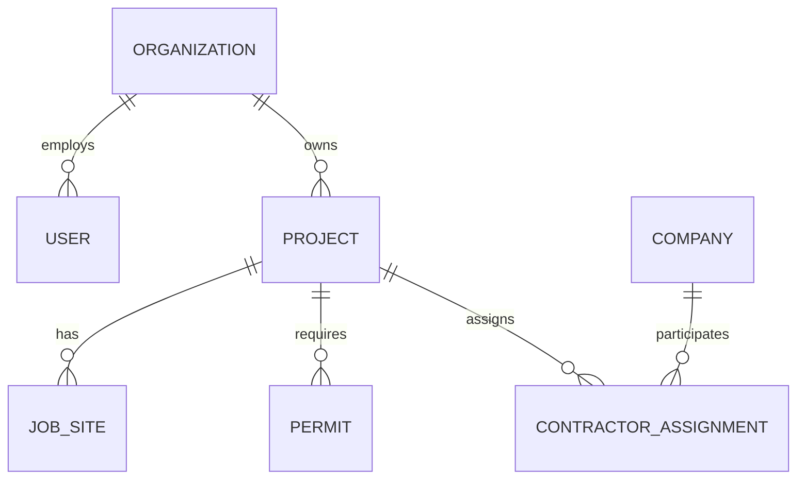

# Milestone 1 Report — Core Domain (Beginner's Guide to Doctrine ORM & Symfony REST APIs)

## 1. Current Project Status

- **Milestone 0 (Foundation): Complete**
- **Milestone 1 (Core Domain): Complete & verified locally** on Windows PHP `8.2.12` + Symfony `v7.4.23 LTS` + MariaDB `10.4.32` (`11 tests, 117 assertions` passing).
- **Milestone 2 (Document Management): Not started yet** (say `next` when ready).

---

## 2. Doctrine ORM vs. Laravel Eloquent (Beginner Cheat Sheet)

| Concept | Laravel (Eloquent) | Symfony (Doctrine ORM 3.8) |
|---|---|---|
| **Pattern** | Active Record (`$project->save()`) | Data Mapper (`$em->persist($project); $em->flush();`) |
| **Table mapping** | `$table = 'projects'` + migration | PHP 8 Attributes (`#[ORM\Entity]`, `#[ORM\Table]`, `#[ORM\Column]`) |
| **Migrations** | `php artisan make:migration` / `migrate` | `php bin/console doctrine:migrations:diff` / `doctrine:migrations:migrate` |
| **Seeders** | `DatabaseSeeder` (`php artisan db:seed`) | `AppFixtures` (`php bin/console doctrine:fixtures:load`) |
| **Queries** | `Project::with('permits')->get()` | `ProjectRepository` (`QueryBuilder` with `innerJoin` / `leftJoin` + `addSelect`) |
| **Validation** | `FormRequest` rules array | DTO class with `#[Assert\NotBlank]`, `#[Assert\Email]`, `#[Assert\Choice]` |
| **Schema check** | Manual inspection | `php bin/console doctrine:schema:validate` |

---

## 3. Domain Model Created in Milestone 1



| Module | Entity | Table | Key Indexes & Constraints |
|---|---|---|---|
| `Organizations` | [Organization](file:///e:/construction-compliance-platform/src/Organizations/Domain/Entity/Organization.php) | `organizations` | `UNIQUE(code)`, `INDEX(status)` |
| `Identity` | [User](file:///e:/construction-compliance-platform/src/Identity/Domain/Entity/User.php) | `users` | `UNIQUE(email)`, `INDEX(role)`, `INDEX(organization_id, role)` |
| `Projects` | [Project](file:///e:/construction-compliance-platform/src/Projects/Domain/Entity/Project.php) | `projects` | `UNIQUE(code)`, `INDEX(status)`, `INDEX(organization_id, status)` |
| `Projects` | [JobSite](file:///e:/construction-compliance-platform/src/Projects/Domain/Entity/JobSite.php) | `job_sites` | `INDEX(jurisdiction)`, `INDEX(city)`, `FK(project_id)` |
| `Contractors` | [Company](file:///e:/construction-compliance-platform/src/Contractors/Domain/Entity/Company.php) | `companies` | `UNIQUE(license_number)`, `INDEX(normalized_name)`, `INDEX(trade)`, `INDEX(status)` |
| `Contractors` | [ContractorAssignment](file:///e:/construction-compliance-platform/src/Contractors/Domain/Entity/ContractorAssignment.php) | `contractor_assignments` | `UNIQUE(project_id, company_id)`, `INDEX(status)` |
| `Permits` | [Permit](file:///e:/construction-compliance-platform/src/Permits/Domain/Entity/Permit.php) | `permits` | `UNIQUE(permit_number)`, `INDEX(status)`, `INDEX(permit_type)`, `INDEX(expires_at)`, `INDEX(project_id, status)` |

---

## 4. Doctrine Performance Practices Implemented

1. **N+1 Prevention + Avoiding Cartesian Products** ([ProjectRepository.php](file:///e:/construction-compliance-platform/src/Projects/Infrastructure/Repository/ProjectRepository.php)):
   - Instead of lazy-loading `jobSites`, `contractorAssignments`, and `permits` per project (which fires `1 + 3N` queries), `findAllWithDetails()` runs **4 constant `O(1)` queries**:
     1. Load `Project` + `INNER JOIN organization`
     2. Hydrate `jobSites` for `p.id IN (:ids)`
     3. Hydrate `contractorAssignments` + `company` for `p.id IN (:ids)`
     4. Hydrate `permits` for `p.id IN (:ids)`
   - Verified automatically in `CoreDomainApiTest::testProjectRepositoryEagerLoadingInitializesAllRelationsWithoutNPlusOne()`.
2. **Database Indexes & `EXPLAIN` Verification**:
   - `EXPLAIN SELECT * FROM permits WHERE project_id = 1 AND status = 'approved'` uses composite index `idx_permits_project_status` (`type=ref`, `rows=1`, `Using index condition`).
   - `EXPLAIN SELECT * FROM projects WHERE organization_id = 1 AND status = 'active'` uses `idx_projects_status` (`type=ref`, `Using index condition`).
3. **Batching with `flush()` and `clear()`** ([AppFixtures.php](file:///e:/construction-compliance-platform/src/Shared/DataFixtures/AppFixtures.php)):
   - Bulk-inserts 25 regional trade contractors in batches of 10, calling `$manager->flush(); $manager->clear();` after each batch so Doctrine's `UnitOfWork` memory stays flat.

---

## 5. REST API Endpoints

| Method | Endpoint | Purpose |
|---|---|---|
| `GET` | `/api/organizations` | List organizations |
| `GET` | `/api/organizations/{id}` | Get one organization |
| `POST` | `/api/organizations` | Create organization (`422` validation, `409` duplicate code) |
| `GET` | `/api/users` | List users (supports `?organization_id=` & `?role=`) |
| `POST` | `/api/users` | Create user (`404` missing org, `409` duplicate email) |
| `GET` | `/api/projects` | List projects with eager-loaded `job_sites`, `contractors`, `permits` (`?organization_id=`, `?status=`) |
| `GET` | `/api/projects/{id}` | Get one project with full details |
| `POST` | `/api/projects` | Create project (`422` if `ends_at < starts_at`, `409` duplicate code) |
| `POST` | `/api/projects/{id}/job-sites` | Add a job site to a project |
| `POST` | `/api/projects/{id}/contractors` | Assign a contractor to a project (`409` if already assigned) |
| `GET` | `/api/contractors` | List contractors (`?trade=`, `?status=`) |
| `GET` | `/api/contractors/{id}` | Get one contractor |
| `POST` | `/api/contractors` | Create contractor (auto-computes `normalized_name`, `409` duplicate license) |
| `GET` | `/api/permits` | List permits (`?project_id=`, `?status=`) |
| `POST` | `/api/permits` | Create permit (`422` if `expires_at < issued_at`, `409` duplicate permit number) |

---

## 6. Local Commands for Milestone 1

```powershell
# Run migrations on dev & test databases
php bin/console doctrine:migrations:migrate --no-interaction
php bin/console doctrine:migrations:migrate --env=test --no-interaction

# Validate ORM mappings & DB schema sync
php bin/console doctrine:schema:validate

# Load realistic construction seed data
php bin/console doctrine:fixtures:load --no-interaction

# Start local API server (port 8085)
php -S 127.0.0.1:8085 -t public

# Test live endpoints
curl.exe -sS http://127.0.0.1:8085/api/projects
curl.exe -sS http://127.0.0.1:8085/api/contractors

# Run automated tests
php bin/phpunit
```
