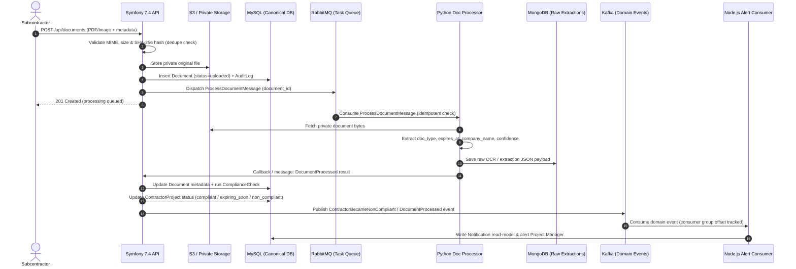
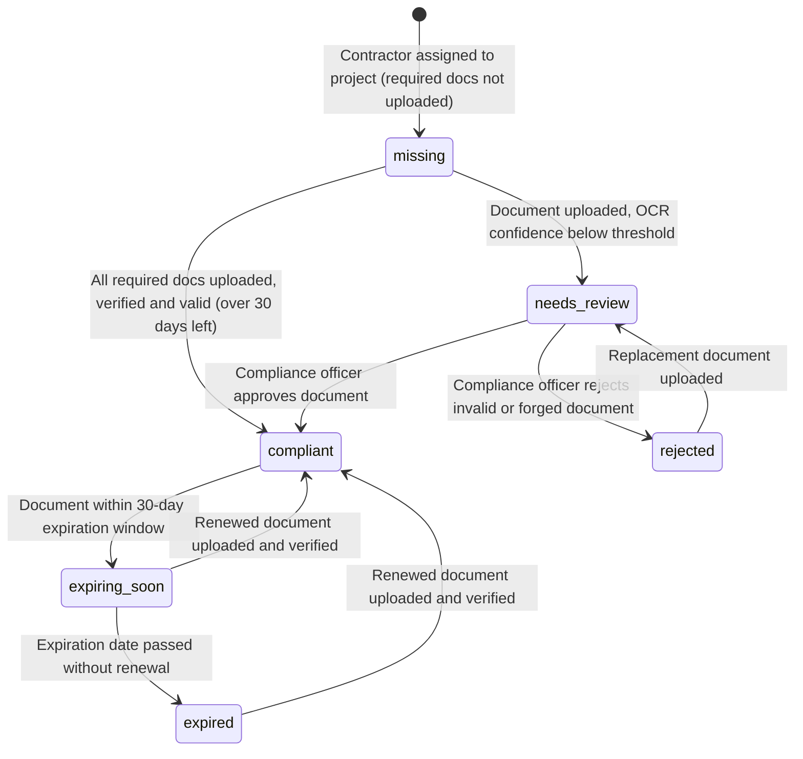
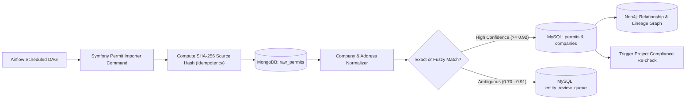
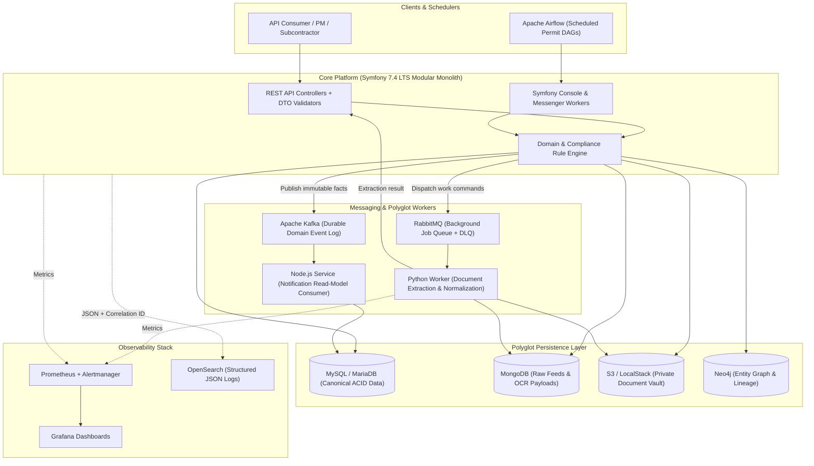

# BuildGuard — System Blueprint, Business Domain & Architecture Specification

> **Purpose of this document:** End-to-end product, domain, database, and distributed-services blueprint for **BuildGuard**, a production-style construction project compliance platform inspired by Procore.

---

## 1. Business Domain: How Construction Compliance Works

Commercial construction projects (high-rise towers, bridges, hospitals, industrial plants) are not built by a single company. A **General Contractor (GC)** or **Owner/Developer** coordinates **20 to 100+ specialized trade subcontractors** (electrical, structural steel, plumbing, HVAC, excavation, crane rigging) across multiple physical **job sites** and municipal **jurisdictions**.

Before a subcontractor sets foot on a job site — and every single day work continues — the GC is legally and financially exposed to three major compliance risks:

1. **Uninsured or Underinsured Contractors:** Every subcontractor must carry active General Liability, Workers' Compensation, and Umbrella **Certificates of Insurance (COIs)** plus valid state trade licenses and OSHA safety certifications. If an electrical subcontractor's COI quietly expired yesterday and an accident occurs today, liability falls back onto the GC and project owner.
2. **Missing or Expired Municipal Permits & Inspections:** Construction phases depend on government-issued permits (`building`, `electrical`, `plumbing`, `mechanical`, `environmental`) and passed site inspections. Working under an expired or unapproved permit triggers municipal **Stop-Work Orders**, fines, and costly schedule delays.
3. **Dirty, Siloed External Data:** Public municipal permit portals publish company names and site addresses inconsistently (`"ABC Electrical, LLC"` vs `"A.B.C. Electric Inc"` vs `"ABC Elec."`). Matching external permit feeds to internal projects and contractors requires **raw payload preservation, normalization, entity resolution, and human review queues**.

### The Core Business Question

Every module, table, worker, and event in BuildGuard exists to answer one operational question accurately and audibly at any moment:

> **"Is this contractor allowed to work on this project today, and are all required documents, safety certificates, and municipal permits valid?"**

### Domain Actors & Responsibilities

| Actor | Real-World Role | Key Actions in BuildGuard |
|---|---|---|
| **Organization Admin** | GC / Developer operations lead | Creates organization, configures compliance rules, manages users & roles |
| **Project Manager (PM)** | Owns schedule & trade coordination on a project | Creates projects & job sites, assigns subcontractors, receives non-compliance alerts |
| **Safety / Compliance Officer** | Audits documents, permits & site inspections | Reviews low-confidence extracted documents, logs inspections, resolves entity matches |
| **Subcontractor Admin** | Office manager at a trade company (e.g., ABC Electrical) | Uploads COIs, safety certificates, and trade licenses; renews expiring documents |
| **Compliance Auditor** | Insurance / legal / municipal reviewer | Inspects immutable audit trails, compliance check history, and merge lineage |

---

## 2. End-to-End Business Workflows

### 2.1 Document Upload, Extraction & Compliance Evaluation Flow

### 2.2 Compliance Status Lifecycle

Each `(Project, Company)` assignment is continuously evaluated against the project's `ComplianceRequirement` rules:

### 2.3 Scheduled Public Permit Ingestion & Entity Resolution Flow

---

## 3. Functional & Non-Functional Requirements

### 3.1 Modular Functional Requirements (Symfony Modular Monolith)

| Symfony Module | Core Responsibilities |
|---|---|
| **`Organizations`** | Multi-tenant organization profiles (`code`, `name`, `status`) owning projects, users, and compliance policies. |
| **`Identity`** | Users, role definitions (`admin`, `project_manager`, `safety_officer`, `contractor_admin`, `auditor`), authentication & authorization. |
| **`Projects`** | Construction projects (`planning`, `active`, `on_hold`, `completed`), timelines, and physical `JobSite` locations with municipal jurisdictions. |
| **`Contractors`** | Subcontractor companies, canonical name normalization, trade classifications, license numbers, and `ContractorAssignment` links to projects. |
| **`Permits`** | Municipal permits (`building`, `electrical`, `plumbing`, `mechanical`, `environmental`), public permit ingestion, normalization, and expiration tracking. |
| **`Inspections`** | Scheduled and completed municipal/safety site inspections (`passed`, `failed`, `reinspection_required`) linked to projects and permits. |
| **`Documents`** | Secure upload, MIME/size validation, SHA-256 deduplication, private S3/LocalStack storage, presigned access, and version history. |
| **`Compliance`** | Rule engine evaluating `ComplianceRequirement` rules per project/trade against uploaded `Document` and `Permit` state to produce `ComplianceCheck` results. |
| **`Notifications`** | Event-driven alerts for Project Managers and Subcontractors when documents expire, permits fail, or contractors become non-compliant. |
| **`Reporting`** | Project readiness summaries, expiring-document digests, audit exports, and entity-resolution precision/recall metrics. |
| **`Shared`** | Cross-cutting infrastructure: DB health probes (`/health`), safe JSON request/validation helpers, audit logging, correlation IDs, and fixtures. |

### 3.2 Non-Functional & Production Readiness Requirements

- **Security by Default:** Never commit `.env` secrets; validate all external input via DTO constraints; enforce authorization; store uploaded files privately (never public buckets); never leak raw SQL/stack traces in API responses.
- **Idempotency Everywhere:** RabbitMQ consumers, Kafka consumers, and permit importers must safely handle duplicate deliveries using message IDs, state guards, and SHA-256 content/source hashes.
- **Query & Memory Discipline:** Eliminate ORM N+1 queries via multi-step hydration; index foreign keys and filter predicates (`EXPLAIN`-verified); bound memory on bulk operations with chunked `flush()` + `clear()`.
- **Observability:** Structured JSON logs with correlation IDs (OpenSearch), queue depth / latency / compliance freshness metrics (Prometheus + Grafana), and actionable alerts (Alertmanager).
- **Resilience Tested via Failure Drills:** Every milestone includes explicit failure drills (DB down, storage down, poison queue message, source timeout, bad K8s rollout).

---

## 4. Complete Data Architecture & Table Relationships

BuildGuard uses **polyglot persistence** intentionally — each data store handles the workload it was designed for, while **MySQL/MariaDB remains the single transactional source of truth**.

### 4.1 Relational Schema (MySQL / MariaDB — Canonical Source of Truth)

```mermaid
erDiagram
    ORGANIZATIONS ||--o{ USERS : employs
    ORGANIZATIONS ||--o{ PROJECTS : owns
    ORGANIZATIONS ||--o{ AUDIT_LOGS : records

    PROJECTS ||--o{ JOB_SITES : located_at
    PROJECTS ||--o{ CONTRACTOR_ASSIGNMENTS : assigns
    PROJECTS ||--o{ PERMITS : requires
    PROJECTS ||--o{ INSPECTIONS : undergoes
    PROJECTS ||--o{ COMPLIANCE_REQUIREMENTS : defines
    PROJECTS ||--o{ COMPLIANCE_CHECKS : evaluates

    COMPANIES ||--o{ CONTRACTOR_ASSIGNMENTS : participates_in
    COMPANIES ||--o{ DOCUMENTS : uploads
    COMPANIES ||--o{ COMPLIANCE_CHECKS : subject_of
    COMPANIES ||--o{ COMPANY_MERGE_LINEAGE : tracks_merges

    DOCUMENT_TYPES ||--o{ DOCUMENTS : classifies
    DOCUMENT_TYPES ||--o{ COMPLIANCE_REQUIREMENTS : requires

    PERMITS ||--o{ INSPECTIONS : inspected_for
    USERS ||--o{ NOTIFICATIONS : receives

    ORGANIZATIONS {
        int id PK
        string name
        string code UK
        string status "active | inactive"
        datetime created_at
        datetime updated_at
    }

    USERS {
        int id PK
        int organization_id FK
        string email UK
        string full_name
        string role "admin | project_manager | safety_officer | contractor_admin | auditor"
        boolean is_active
        datetime created_at
    }

    PROJECTS {
        int id PK
        int organization_id FK
        string name
        string code UK
        string status "planning | active | on_hold | completed"
        date starts_at
        date ends_at
        datetime created_at
    }

    JOB_SITES {
        int id PK
        int project_id FK
        string name
        string address_line1
        string city
        string state
        string postal_code
        string jurisdiction
    }

    COMPANIES {
        int id PK
        string name
        string normalized_name "Indexed for entity resolution"
        string trade "electrical | plumbing | structural_steel | hvac"
        string license_number UK
        string tax_id
        string status "pending | compliant | conditional | non_compliant | suspended"
    }

    CONTRACTOR_ASSIGNMENTS {
        int id PK
        int project_id FK "UK(project_id, company_id)"
        int company_id FK "UK(project_id, company_id)"
        string role_on_project
        string status "assigned | active | completed | suspended"
        datetime assigned_at
    }

    PERMITS {
        int id PK
        int project_id FK
        string permit_number UK
        string permit_type "building | electrical | plumbing | mechanical | environmental"
        string issuing_authority
        string status "draft | submitted | under_review | approved | expired | closed"
        date issued_at
        date expires_at "Indexed"
    }

    INSPECTIONS {
        int id PK
        int project_id FK
        int permit_id FK "Nullable"
        string inspection_type
        string inspector_name
        string status "scheduled | passed | failed | reinspection_required"
        datetime scheduled_at
        datetime completed_at
    }

    DOCUMENT_TYPES {
        int id PK
        string code UK "insurance_certificate | safety_certificate | trade_license | w9"
        string name
        boolean requires_expiration
    }

    DOCUMENTS {
        int id PK
        int company_id FK
        int project_id FK "Nullable"
        int document_type_id FK
        string storage_key UK "Private S3 object key"
        string sha256_hash "Indexed for duplicate detection"
        string mime_type
        int file_size_bytes
        string status "uploaded | processing | verified | rejected | needs_review | expired"
        float extraction_confidence
        date expires_at "Indexed"
        datetime uploaded_at
    }

    COMPLIANCE_REQUIREMENTS {
        int id PK
        int project_id FK
        int document_type_id FK
        string required_for_trade "Nullable"
        int warning_days_before_expiry "Default 30"
        boolean is_mandatory
    }

    COMPLIANCE_CHECKS {
        int id PK
        int project_id FK
        int company_id FK
        string overall_status "compliant | expiring_soon | expired | missing | rejected | needs_review"
        json missing_documents
        json expiring_documents
        datetime evaluated_at
    }

    COMPANY_MERGE_LINEAGE {
        int id PK
        int survivor_company_id FK
        int merged_company_id FK
        json snapshot_before_merge "Supports clean unmerge"
        string match_method "exact | fuzzy | manual_review"
        float match_score
        datetime merged_at
    }

    NOTIFICATIONS {
        int id PK
        int recipient_user_id FK
        string event_id UK "Kafka event ID for idempotency"
        string type "contractor_non_compliant | document_expiring | permit_approved"
        string title
        json payload
        datetime read_at
        datetime created_at
    }

    AUDIT_LOGS {
        bigint id PK
        int organization_id FK
        int actor_user_id FK "Nullable"
        string action "document.uploaded | contractor.assigned | company.merged"
        string target_type
        string target_id
        json metadata
        datetime occurred_at
    }
```

### 4.2 Polyglot Data Ownership Matrix

| Store | What It Stores | Why Not Put Everything in MySQL? |
|---|---|---|
| **MySQL / MariaDB** | Organizations, Users, Projects, JobSites, Companies, Permits, Documents metadata, ComplianceChecks, AuditLogs | ACID transactions, foreign-key integrity, predictable indexed joins for core compliance state. |
| **S3 / LocalStack** | Original PDF/PNG insurance & safety files | Binary blobs bloat relational backups and buffer pools; S3 provides cheap, durable private object storage with presigned access. |
| **MongoDB** | Raw municipal permit JSON feeds (`raw_permits`) & raw OCR/extraction outputs (`document_extractions`) | External city APIs change schemas unpredictably; storing untouched raw JSON with a `source_hash` enables schema-free ingestion and full replay. |
| **Neo4j** | Entity relationships (`Company` -> `ASSIGNED_TO` -> `Project`, `Company` -> `SAME_LICENSE_AS` -> `Company`, merge lineage) | Multi-hop graph queries (e.g., *"Find all active projects exposed to subcontractors sharing a tax ID or license with a suspended vendor"*) are natural in Cypher. |

---

## 5. Distributed Services & Messaging Architecture

### Why Both RabbitMQ AND Kafka? (Key Architectural Distinction)

| Dimension | **RabbitMQ (Task Queue)** | **Apache Kafka (Event Stream)** |
|---|---|---|
| **Intent** | **Commands / Background Work:** *"Please extract metadata from document #42."* | **Domain Facts / Events:** *"Contractor ABC Electrical became non-compliant on Downtown Tower."* |
| **Message Lifecycle** | Deleted once acknowledged by a worker (`ack`); failed jobs route to retry queues and a Dead-Letter Queue (DLQ). | Retained durably on disk by retention policy; consumers track offsets and can **replay historical events** to rebuild read models. |
| **Consumers** | Single worker pool (Symfony Messenger / Python document processor) competing for tasks. | Multiple independent consumer groups (Node.js notifications, analytics, audit archivers) reading the same stream independently. |

---

## 6. Milestone Delivery Roadmap

| Milestone | Scope | Status |
|---|---|---|
| **Milestone 0** | Foundation: Symfony 7.4 LTS, Doctrine DBAL, Monolog, `/health` probe, PHPUnit, failure drill | **Complete** |
| **Milestone 1** | Core Domain: `Organizations`, `Identity`, `Projects`, `Contractors`, `Permits`, migrations, fixtures, N+1-safe repositories, `EXPLAIN`, REST API | **Complete** |
| **Milestone 2** | Document Management: Upload API, MIME/size validation, SHA-256 deduplication, private S3/LocalStack storage, audit logs | Planned |
| **Milestone 3** | Asynchronous Processing: Symfony Messenger + RabbitMQ, retries, failure transport, DLQ, idempotent consumers | Planned |
| **Milestone 4** | Python Document Processor: Document type & expiration extraction, confidence scoring, `pytest` suite | Planned |
| **Milestone 5** | Compliance Engine: Project/trade requirements, missing & expiring detection, compliance check endpoints | Planned |
| **Milestone 6** | Permit Ingestion: Public permit importer command, MongoDB raw store, SHA-256 source hashing, project matching | Planned |
| **Milestone 7** | Entity Resolution & Neo4j: Company/address normalization, fuzzy matching, review queue, merge/unmerge lineage, Cypher graph | Planned |
| **Milestone 8** | Event Streaming: Kafka domain topics, partition strategy, replay, Node.js notification consumer | Planned |
| **Milestone 9** | Observability: Prometheus metrics, Grafana dashboards, JSON correlation-ID logs in OpenSearch, incident drill | Planned |
| **Milestones 10–15** | Delivery & Cloud: Hardened Dockerfiles, Trivy scans, Kubernetes (`kind`) + Helm, Terraform AWS modules, CI/CD, Airflow DAG, ADRs & runbooks | Planned |
